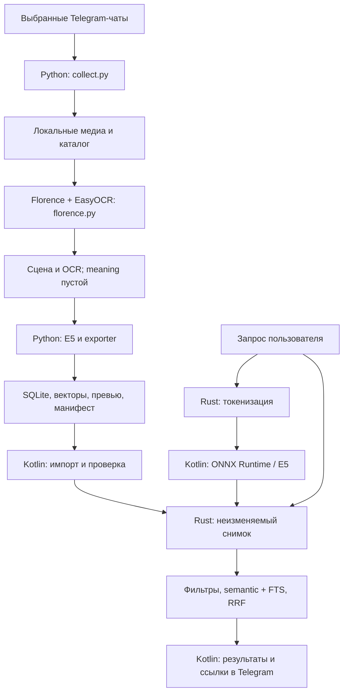

# Как устроена текущая реализация

Документ описывает существующий код прототипа. Дорожная карта находится в [плане](DEVELOPMENT_PLAN.md), результаты проверок — в [статусе](IMPLEMENTATION_STATUS.md), команды — в [руководстве](OPERATIONS.md).

## Основная идея

ПК получает английские подписи Florence-2 и отдельный OCR ru/en, затем векторизует подписи через E5-small. Телефон векторизует только поисковый запрос и сравнивает его с подготовленными векторами. Тяжёлая VLM и Telegram-сессия на телефоне не нужны.

Текущий семантический поиск **не сравнивает запрос непосредственно с пикселями**. Он зависит от содержания описаний: пропущенная VLM деталь может остаться ненайденной. OCR и подписи дают отдельную лексическую ветвь.

## Кто за что отвечает

| Компонент | Ответственность | Основной файл |
|---|---|---|
| Python collector | История выбранных чатов, медиа, источники | [collect.py](../indexer/src/tg_indexer/collect.py) |
| Python VLM-клиент | Получение и кеширование описаний | [describe.py](../indexer/src/tg_indexer/describe.py) |
| Python exporter | E5, SQLite, превью, пакеты и публикация | [pipeline.py](../indexer/src/tg_indexer/pipeline.py) |
| Rust core | Валидация, фильтры, векторы, FTS, RRF | [lib.rs](../crates/search-core/src/lib.rs) |
| Rust JNI | Handles, токенизация и вызовы ядра | [lib.rs](../crates/search-jni/src/lib.rs) |
| Rust CLI | Проверка и поиск на ПК тем же ядром | [main.rs](../crates/search-cli/src/main.rs) |
| Kotlin ViewModel | Состояние, запросы, импорт и обновления | [SearchViewModel.kt](../android/app/src/main/java/dev/tgfeature/search/SearchViewModel.kt) |
| Kotlin encoder | Исполнение E5 и pooling | [E5Encoder.kt](../android/app/src/main/java/dev/tgfeature/search/E5Encoder.kt) |
| Kotlin importer | Ограниченная распаковка ZIP | [PackageImporter.kt](../android/app/src/main/java/dev/tgfeature/search/PackageImporter.kt) |
| Compose | Файловые диалоги, фильтры, результаты | [MainActivity.kt](../android/app/src/main/java/dev/tgfeature/search/MainActivity.kt) |

Rust поставляет собственный SQLite через `rusqlite` с `bundled`; FTS5 не зависит от SQLite, установленного в Android. Модель исполняется через ONNX Runtime Android 1.22.0; Rust её не исполняет.

## Подготовка архива на ПК

### Сбор сообщений

Collector требует непустой список `chats` и локальные `TG_API_ID` / `TG_API_HASH`. Авторизация Telethon интерактивная, сессия сохраняется в рабочей папке. Код не отправляет сообщения и не вступает в чаты.

Он читает историю от новых сообщений к старым, скачивает фото и документы с MIME `image/*`. `limit_per_chat` ограничивает **количество просмотренных сообщений**, не количество найденных картинок. Повторный запуск снова читает окно истории и пропускает известные ключи; отдельного курсора истории нет.

Идентификаторы:

- `image_id`: SHA-256 скачанных байтов. Одинаковые файлы разделяют медиа и описания; разные JPEG-кодировки одной картинки считаются разными изображениями.
- `message_key`: `<account_id>:<chat_id>:<message_id>`.
- `chat_id` / `sender_id`: строки с результатом Telethon `get_peer_id`, включая знак; имя и username — атрибуты, не ключи.

`catalog.json` сохраняет накопленную рабочую историю. `selected-catalog.json` включает только текущие чаты и даты. Исключение из конфига не удаляет старые файлы из рабочей папки. Уже известные сообщения не перепроверяются: удаление, редактирование подписи или смена отправителя автоматически не отражаются.

Ссылки формируются для каналов и супергрупп: публичные через username, приватные через `t.me/c`. Для обычных групп и личных диалогов ссылка может отсутствовать. Тема берётся из `reply_to_top_id`, если поле доступно; названия тем и источник пересылки пока не собираются.

### Описание картинки

По умолчанию `tg-describe` вызывает локальную native Florence-2-base-ft и EasyOCR ru/en. Зависимости и веса устанавливаются через `scripts/setup-florence.sh`; отдельный HTTP-сервис не нужен. Backend: [florence.py](../indexer/src/tg_indexer/florence.py), подробности — [FLORENCE.md](FLORENCE.md).

| Поле | Источник | Дальнейшее использование |
|---|---|---|
| `scene` | Английская подпись `<DETAILED_CAPTION>` | Обязательный E5-вектор, подпись результата |
| `ocr` | Отдельный EasyOCR ru/en | FTS5 вместе с подписями сообщений |
| `meaning` | Пусто; интерпретация мема не генерируется | Второй вектор отсутствует |

Проверенные по SHA-256 safetensors и конфигурация загружаются только локально через встроенные классы Transformers, без trust_remote_code. Florence использует greedy decoding и до 128 новых токенов; отдельный JSON-ответ модель не генерирует. EasyOCR использует закреплённые веса и tensor-only загрузку PyTorch. Изображения уменьшаются до 1600 по длинной стороне; это может ухудшать чтение мелкого текста. Генерация смысла мема, оценка истинности сцены и Qwen-доразметка не выполняются автоматически.

`florence-catalog.json` сохраняется после каждого результата, отдельно от Qwen. Кеш учитывает ID картинки, model ID и профиль с revision, задачей, лимитом, OCR, хешами OCR и preprocessing. При возобновлении обновляются source-метаданные; ещё не посещённые кешированные результаты сохраняются при записи checkpoint. Маленький прогон `--limit` по умолчанию использует отдельный probe-каталог.

Дополнительный `--backend ollama` сохраняет прежний путь Qwen с локальным `/api/generate`, Instruct и JSON schema, результатом `described-catalog.json`. Этот путь не используется по умолчанию. Описание scene/OCR/meaning формируется Qwen в одном запросе; клиент не устанавливает и не запускает Ollama. Удалённые HTTP endpoints, proxy и redirects запрещены.

### Экспорт

Exporter принимает уже описанный каталог. Для каждого изображения он создаёт одну запись `images`, все сообщения-источники и до двух `representations`. Порядок строк в `representations` соответствует строкам векторного файла.

Превью при наличии исходника уменьшается до 320×320 с сохранением пропорций и сохраняется JPEG quality 75. Лексический документ — OCR и объединённые подписи всех источников. Сцена и интерпретация в FTS не добавляются.

Выходная папка должна быть новой. Exporter закрывает SQLite, затем считает размеры и SHA-256 файлов и записывает манифест. Он **не вызывает Rust validator автоматически**: перед упаковкой/публикацией нужно отдельно выполнить `search-cli validate`.

Неудачный экспорт может оставить частичную папку, упаковка — частичный ZIP. Повторный запуск с тем же именем их не перезаписывает; используйте новое имя и не публикуйте непроверенный результат.

## Один embedding space на обеих платформах

Выбран `intfloat/multilingual-e5-small`, revision `614241f622f53c4eeff9890bdc4f31cfecc418b3`. Используется закреплённый ONNX INT8-файл `model_qint8_avx512_vnni.onnx`, локально переименованный в `model.onnx`. Несмотря на имя исходного файла, этот конкретный артефакт проверен на подключённом ARM64-телефоне.

Правила кодирования одинаковы:

1. `query: <текст>` для запроса; `passage: <описание>` для документа.
2. Токенизация из одного `tokenizer.json`, максимум 512 токенов с усечением.
3. ONNX получает `input_ids`, `attention_mask` и нужные ему типы токенов.
4. Masked mean pooling скрытых состояний, затем L2-нормализация.
5. Результат — 384 Float32-компоненты.

INT8 относится к весам модели. Файл векторов остаётся Float32. E5 поддерживает текстовые описания; визуальный энкодер CLIP/Qwen-VL в основной путь не включён.

Идентификатор пространства включает первые 16 hex-символов хешей модели и токенизатора. Android дополнительно разрешает только **полные закреплённые SHA-256** обоих файлов. Замена модели требует обновления APK, проверки качества и пересчёта снимка; одинаковая размерность не делает другие модели совместимыми.

## Как выполняется поиск

1. ViewModel сериализует работу через coroutine `Mutex`. E5 и JNI вызываются на `Dispatchers.IO`.
2. Rust выбирает допустимые изображения по сообщениям. Все фильтры должны выполняться **у одного источника**, а не у разных сообщений одной картинки.
3. Для каждого допустимого представления считается dot product. Благодаря нормализации это cosine similarity. По каждому виду описания берётся лучшая оценка изображения.
4. Каждая семантическая ветвь получает до `clamp(top_k × 10, 100, 1000)` кандидатов. В UI `top_k=20`, то есть до 200 на ветвь.
5. Запрос разбивается по неалфавитно-цифровым символам; первые 64 токена заключаются в кавычки и объединяются через `OR`. FTS5 сортирует по BM25, с теми же фильтрами.
6. Списки объединяются равновесным RRF: `score(image) = sum(1 / (60 + rank))`, где rank начинается с 1. Равные итоговые оценки разрешаются по `image_id`.
7. Возвращаются top-k изображений и до 50 подходящих источников каждого, от новых сообщений к старым.

Порог минимального semantic score не задан: даже нерелевантный запрос может получить результаты, если архив непустой. RRF-score не является вероятностью. Реранкер, русская морфология, fuzzy matching и сортировка всей выдачи по свежести пока отсутствуют. Даты используются как фильтр; порядок источников по дате не меняет общий порядок картинок.

Векторы целиком загружаются в Rust `Vec<f32>`, без mmap и ANN. Поиск проходит все представления: вычисления для разрешённых строк стоят порядка `O(N × 384)`, метаданные читаются из SQLite. Память включает сами векторы, допустимые ID и промежуточные оценки. Замеры на 100k картинок ещё не выполнены.

## Граница JNI и время жизни

Kotlin передаёт JSON-запрос с текстом, вектором, фильтрами и top-k; возвращается небольшой JSON-ответ. Сам индекс через JNI не копируется. Публичный контракт описан в [API.md](API.md).

Каждая сессия хранится в Rust-реестре по числовому handle: `Arc<Session>` содержит `Mutex<Snapshot>` и атомарный флаг отмены. Максимум — восемь зарегистрированных сессий. `close` удаляет handle и выставляет отмену; уже получивший `Arc` вызов сохраняет ресурсы до завершения.

`cancel` кооперативный: ядро проверяет флаг в поисковых циклах. Он не прерывает ONNX-инференс и не гарантирует немедленную остановку SQL-запроса. Новый native search сбрасывает флаг; это не постоянный запрет работы с сессией. `generation` в ViewModel дополнительно не даёт старой выдаче заменить новую.

Ожидаемые ошибки сериализуются как `{ok:false,error:...}`. Rust panic перехватывается на JNI-границе, но это не защита от всех нативных сбоев/OOM. При уничтожении ViewModel закрытие ресурсов ждёт её mutex, чтобы не закрыть ещё исполняемую модель или завершающуюся инициализацию.

## Импорт и обновление

Приватные данные Android размещаются в `files/search/`: папки `model-<uuid>`, `snapshot-<uuid>` и `active.json`. Указатель содержит только имена обеих папок; сохраняется через Android `AtomicFile`. Веса и снимки импортируются независимо.

Порядок импорта: распаковка в новую папку → проверка модели или Rust `Snapshot::open` → запись указателя → переключение сессии → закрытие предыдущей. При ошибке **до commit** удаляется новая staging-папка, предыдущий указатель остаётся. Старые успешно импортированные папки сохраняются.

Есть важная граница гарантии: импорт валидного снимка с другим embedding space сейчас может переключить указатель, после чего `updateReady` отключит поиск. Проверка совместимости перед commit и интерфейс отката — ещё задачи. Не обещаем сохранение работоспособного поиска при любой ошибке после commit.

Обновления из папки:

1. Пользователь предоставляет SAF-доступ к папке доставки; разрешение сохраняется.
2. По кнопке читается `latest.json` (до 64 KiB). Для установленного архива проверяются dataset ID и увеличение версии.
3. ZIP копируется в собственный cache, проверяются размер и SHA-256.
4. Общий importer проверяет содержимое; dataset/version внутри снимка должны совпадать с latest-манифестом.
5. Временный ZIP удаляется; активная база никогда не открывается непосредственно в папке Syncthing.

Фоновая синхронизация, HTTPS, дельты и уборка старых версий не реализованы. Syncthing только доставляет файлы; его Android-клиент не является частью приложения. Ручной импорт не применяет ограничения dataset/монотонности версии из режима обновлений.

## Защита и границы проверок

ZIP importer ограничивает число записей, суммарную распаковку и доступный диск; запрещает traversal/дубли путей и пишет обычные файлы. Rust проверяет хеши, размеры, counts, индексы, конечность и норму векторов, часть метаданных и привязку превью. Это не полная формальная валидация всех бизнес-инвариантов SQLite.

Манифест не подписан: SHA-256 подтверждает целостность, но не авторство. Снимки содержат приватную информацию, даже без оригиналов. APK запрашивает INTERNET для добровольного скачивания закреплённого E5-small с Hugging Face по HTTPS; архивы и запросы остаются локальными. Чтение Telegram-кеша и Telegram-сессия не используются; резервное копирование и перенос данных приложения отключены в манифесте/правилах backup.

В smoke test на телефоне проверены native загрузка, E5, первый semantic результат, фильтр отправителя и отклонение закрытого handle. Это не проверка качества мемов, масштабирования, всех UI-импортов или всех гонок lifecycle. VLM проверена на синтетических изображениях через локальную Ollama; качество реальных мемов и полноценная доставка через Syncthing ещё не подтверждены.

## Контроль частоты и наблюдаемость сборщика

[telegram_rate.py](../indexer/src/tg_indexer/telegram_rate.py) оборачивает отправку RPC через `_call` Telethon 1.40.0. Общий монотонный limiter сериализует разрешения, включая внутренние повторы и медиа/CDN; пакет RPC получает отдельное разрешение на каждый запрос. FloodWait перехватывается с явным логом и ожиданием. Служебный транспорт не входит в счётчик. Обновление Telethon требует проверки этого адаптера.

[observability.py](../indexer/src/tg_indexer/observability.py) даёт текстовую шкалу и ограниченные по размеру приватные логи. Collector сообщает стадийные счётчики без идентификаторов чатов и содержания сообщений; describe показывает новые и кешированные описания, export — векторизацию. Процент сбора считается от максимума просмотренных сообщений, а не от числа фото. [Настройка и диагностика](OPERATIONS.md#лимит-запросов-логи-и-прогресс).
